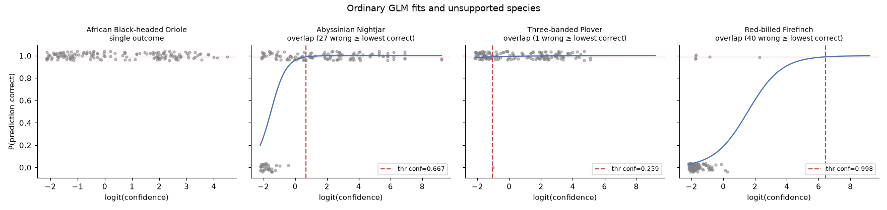

# Bird analysis

The supplied data contain **29,491 predictions and 551 expert validations** across four species. The brief asks for a species-specific cutoff where fitted correctness reaches 99%, plus an `observation` label. The result is exploratory calibration with an explicit support policy; it does not establish independent population precision or count individual birds.

## Method and evidence

The reusable model in `src/birds.py` fits a binomial GLM separately by species:

`logit(P(correct)) = intercept + slope × logit(BirdNET score)`.

Scores are clipped at `1e-4` before transformation. BirdNET sensitivity 1.0 is assumed and requires run-metadata confirmation. For a positive slope, solve the fitted relationship at `P(correct)=0.99` to obtain a raw-score cutoff. This follows the supplied Wood & Kahl reference and the brief. We then distinguish a numerically fitted cutoff from a cutoff eligible for exploratory labels.

| Species | Checked correct / total | Fitted score cutoff | Policy decision | Final observations |
|---|---:|---:|---|---:|
| Abyssinian Nightjar | 117 / 150 | 0.666638 | Exploratory fit supported by this screening policy | 3,147 |
| Three-banded Plover | 149 / 150 | 0.258802 | Pending review: one observed error | 0 |
| African Black-headed Oriole | 150 / 150 | Not fitted | Single outcome class cannot identify the ordinary relationship | 0 |
| Red-billed Firefinch | 6 / 101 | 0.998380 | Target exceeds validated score range | 0 |

Plover has **538 fitted candidates**. They retain candidate labels for review but receive `unconfirmed` in the final `observation` field. Its shallow, uncertain slope makes the cutoff sensitive to modelling choices. Withholding it is a review decision, not evidence that the species is absent. Five observed errors is the policy's transparent screening heuristic; it is not a universal scientific standard. A slope p-value alone is not an acceptance rule.

## What the uncertainty means

At the fitted Nightjar cutoff, 74 of 74 checked predictions are correct; the one-sided exact 95% lower bound is about **96.0%**. At the fitted Plover cutoff, 99 of 100 are correct; the corresponding lower bound is about **95.3%**. These thresholds were fitted on the same checked data, so these are in-sample diagnostics. Clip correlation and the validation sampling design further limit a population interpretation. Neither result independently certifies 99% precision.

Checked-sample precision is 78.0% for Nightjar. Reweighting score bins to the prediction distribution gives about 70.8%, conditional on representative checking within each bin and transferable validation. Firefinch has about 1.3% of prediction mass in unchecked bins; the missing-bin scenarios range from about 5.46% to 6.74% overall correctness. Those scenarios are not confidence intervals. Oriole's 100% checked estimate is not certainty.

Oriole's 150/150 correct checks give a one-sided exact 95% lower bound of about **98.0%**. None of these checked-sample lower bounds reaches 99%. About **299 error-free checks** are needed for an all-correct sample's one-sided 95% lower bound to reach 99%, assuming independent, representative checks at a prespecified cutoff. Selecting and assessing the cutoff on the same data adds optimism. This is an additional evidential standard, not the brief's stated fitted-probability requirement.

Oriole is withheld because the ordinary GLM cannot identify the intercept and score relationship with only one outcome class. Its ordinary slope is **not estimable**, rather than estimated as zero or negative. The Firth diagnostic has a slightly negative slope (about -0.057) and supplies no increasing cutoff. Zero labelled observations therefore reflect a method limitation; they do not imply weak sample correctness or absence.

## Estimator sensitivity

The same validation score/outcome pairs are fitted with Firth's Jeffreys-prior penalty in `fit_firth`. Scores are transformed internally, constant or invalid inputs are rejected, the scoring steps are limited and halved against the penalized likelihood, and convergence is reported. A failed fit exports no cutoff. The implementation follows the modified-score formulation in the [CRAN logistf documentation](https://cran.r-project.org/web/packages/logistf/refman/logistf.html); it is a focused Python implementation, not an independently validated replacement for that package.

| Species | Ordinary GLM cutoff | Firth cutoff | Firth candidates |
|---|---:|---:|---:|
| Abyssinian Nightjar | 0.6666 | 0.7086 | 2,931 |
| Three-banded Plover | 0.2588 | 0.8174 | 114 |
| African Black-headed Oriole | Not estimable | No increasing cutoff | 0 |
| Red-billed Firefinch | 0.9984 | 0.9990 | 0 |

Plover's large cutoff change supports caution about sparse-error calibration. Nightjar changes less, but its label count still depends on the estimator. Firth can shrink fitted probabilities towards one half, especially with imbalanced outcomes; estimator differences alone do not establish which cutoff is scientifically correct (see [Puhr et al.](https://arxiv.org/abs/2101.07620)). These results are a sensitivity check only. The existing ordinary-GLM policy and final observation labels remain unchanged. All four fits converge on the supplied inputs; inspect `bird_firth_sensitivity.csv` for iterations and modified-score residuals.

Recall is unavailable: independently labelled audio containing missed calls is absent. The proportion of validated correct predictions retained above a threshold must not be described as ecological recall.

## Provenance and limits

An approximate validation-link audit finds 205 unique candidate matches, 302 unmatched validations and 44 ambiguous validations. This join uses recording and rounded score; it does not verify segment identity. No expert overrides are applied. An unmatched clip does not prove it came from a different run. Clarify the validation sampling process and original clip identifiers before operational use.

The output preserves all prediction rows. A score outside the species' checked range is separately flagged for review. Prediction-row labels are not independent calls, bird abundance or confirmed absence.

## Recommendation

Use the current Nightjar labels for the take-home's exploratory analysis with these limitations visible. Keep Plover pending review, retain Oriole and Firefinch as unconfirmed under the ordinary method, and request validation provenance and deployment metadata. A different estimator or production rule requires a documented decision and independent evaluation.

**Evidence:** [threshold registry](../outputs/bird_thresholds.csv), [labels](../outputs/birdnet_predictions_labelled.csv), [cutoff evidence](../outputs/bird_checked_cutoff_evidence.csv), [bin weighting](../outputs/bird_bin_weighted_precision.csv), [Firth sensitivity](../outputs/bird_firth_sensitivity.csv), [notebook](../notebooks/01_bird_analysis.ipynb). Sources: supplied brief and Wood & Kahl paper in `data/reference/`.
