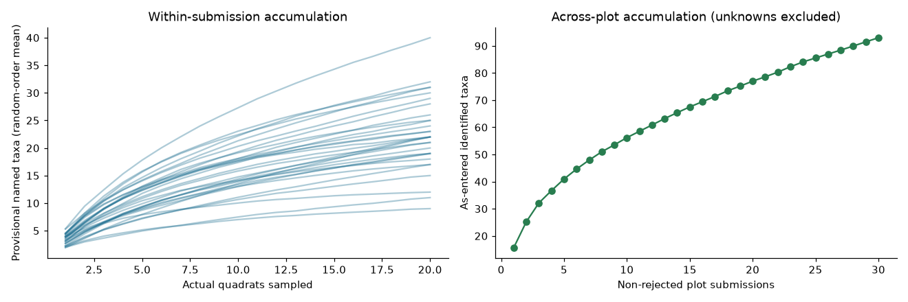
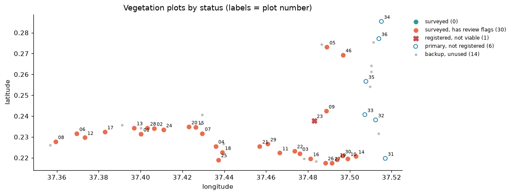

# Vegetation quality report

The exports contain **32 submissions across 30 surveyed plots**. Two explicitly rejected submissions are retained for QA but excluded from ecological summaries. QA covers 640 quadrat records; ecological summaries cover 30 non-rejected submissions and 600 quadrats. Findings flag records for review and never correct original observations.

## Survey summary

All 13 summary integrity checks pass and asserted primary keys are unique. ODK parent keys and entity UUIDs connect surveys, quadrats, additional-species repeats, registered plots and planned centroids. Reconstructing the form's displayed species list matches all 640 quadrats. That verifies the derivation against the export; it does not verify taxonomic truth.

There are **307 issue rows: one error, 271 warnings and 35 informational flags**. Counts refer to findings, so a record can have several flags. The error is a blank species name on Plot 28. Twenty-three submissions have a stored `quadrats_with_species` calculation that differs from a reconstruction using selected known species or named additional-species repeats. These are warnings about derived data. Form versions, calculations, edits or exports may explain them; the cause is unresolved.

All 32 submissions retain a +02:00 device offset rather than expected EAT +03:00. This is informational: the offset alone proves neither a wrong nor a correct clock. Blank optional comments and genuinely empty quadrats are legitimate.

## Plot summary and spatial review

All 30 viable recorded transects depart by more than the analyst's 15-degree review tolerance from north–south. Bearings range from about 49.7 to 130.7 degrees, with median 103.8 degrees. The SOP allows rotation for obstacles or hazards; these exports do not establish the justification. This systematic pattern merits a project-level review, together with plot-level flags.

Finite-segment geometry identifies 127 quadrats outside the recorded belt plus the configured GPS allowance; 33 of these lie beyond recorded endpoints. Geometry flags are review signals, not a diagnosis of their cause.

| Plot | Flagged quadrats / actual quadrats | Median distance to recorded segment | Recorded length |
|---|---:|---:|---:|
| 05 | 19 / 20 | 22.07 m | 45.98 m |
| 27 | 12 / 20 | 14.03 m | 28.57 m |
| 13 | 11 / 20 | 11.47 m | 56.07 m |
| 07 | 9 / 20 | 10.24 m | 52.32 m |
| 19 | 9 / 20 | 8.21 m | 22.65 m |

The highest priority is to compare field layout, registered endpoints and quadrat locations for these plots. Per-submission roll-ups retain the link to individual findings. Plot summaries retain rejected status and do not merge repeated submissions away.

## Sampling effort

All 30 non-rejected submissions contain the prescribed 20 actual quadrats. Random-order accumulation uses these actual sampling units, including real empty quadrats; it never pads missing units. Plot 12 adds about 5.72 taxa in its final five quadrats on the mean curve. Plots 08, 01, 09 and 15 add about 4.46, 4.28, 4.18 and 4.02 taxa respectively. Continued accumulation identifies useful sampling-review priorities. The 10% tail-share category is an analyst heuristic, not proof of ecological adequacy.

Twenty-nine of 36 primary locations were surveyed. Plot 23 is registered non-viable because it is on private property. Backup Plot 46 was surveyed, but no supplied replacement crosswalk proves which primary it replaces. Primaries 31–36 have no registration or survey in the supplied exports and cluster to the north-east. Dataset coverage is incomplete; form completion alone cannot establish representation across locations, habitats or seasons.

Richness remains provisional. Original names are preserved, spelling variants can inflate counts, and unknown morphospecies are not assumed comparable across plots. Form display values and canonical entered names are stored separately.

## Transect map

The [interactive map](../outputs/transect_map.html) and [GeoJSON](../outputs/transects.geojson) retain recorded geometry and planned locations. On the interactive map, transect colour shows spatial review priority, and hovering a transect or quadrat shows its measurements against SOP and analyst tolerances. Its off-line quadrat count (124 of 600) covers accepted submissions only; the 127 Q04 flags above also include the two rejected submissions. The static map shows coverage and review status without requiring web tiles.

## Recommendation

Resolve the blank name, investigate the stored calculations, confirm systematic orientation and unusual plot geometry, and reconcile the planned-location/replacement register. Retain every original value and record any later reviewer decisions separately. Use ecological summaries as provisional descriptive evidence, with protocol completion and broader coverage explicitly distinguished.

**Evidence:** `veg_survey_summary.csv`, `veg_plot_summary.csv`, `veg_sampling_effort.csv`, `veg_qa_flags.csv`, `vegetation_form_calculation_audit.csv`, `vegetation_project_patterns.csv`, `vegetation_spatial_rollup.csv` and `vegetation_plot_coverage.csv` in [outputs](../outputs/). Sources: supplied brief, ODK form workbooks and the two SOPs in `data/`; see [notebook 02](../notebooks/02_vegetation_quality_checks.ipynb) for calculations.
